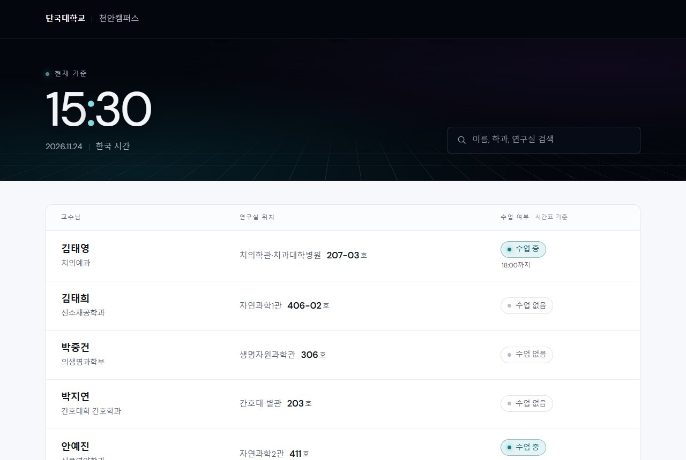

# go.taeheekim.kr

단국대학교 천안캠퍼스 교수님 12명의 연구실 위치와 지금 시간표상 수업 여부를 보여 주는 정적 사이트다. 단국대학교 공식 서비스가 아니다.

[사이트 열기](https://go.taeheekim.kr)

[모바일 화면 보기](docs/mobile.jpg)

## 구조

- `site/index.html` 화면, `site/style.css` 디자인(taeheekim.kr 홈페이지와 같은 규칙), `site/app.js` 수업 여부 계산과 검색, `site/data.js` 교수님 자료.
- `main`에 올리면 `.github/workflows/deploy.yml`이 `site/`를 GitHub Pages로 배포한다. 빌드 단계는 없다.
- 도메인은 가비아 DNS의 `go` CNAME을 `taeheekim2024-star.github.io`로 둔다.

## 자료 고치기

`site/data.js`만 고친다. 시간표는 학사 시스템 표기(`월5,6,7(강의실)/화5,6,7`)를 그대로 쓰고, 학기 기간·휴일·최초 확인일도 이 파일에 있다. 화면 문구는 늘리지 않는다(사이트 제목이나 소개 문장 없음).

## 수업 여부 규칙

- 교시는 천안 2026-2 학사종합안내 138쪽 기준으로 바꾼다. 1~18교시는 09:00부터 30분 단위, 19교시부터는 18:00부터 55분 간격(50분 수업)이다.
- 학기 기간(2026-09-01~2026-12-14) 안의 정규 수업만 반영하고 휴일은 뺀다. 학기 밖이면 '갱신 필요', 시간표가 없으면 '미확인'으로 표시한다.
- '수업 없음'은 연구실에 계신다는 뜻이 아니다. 휴강·보강·분담강의·임상실습의 실제 담당 주차는 반영하지 못한다.

## 확인한 자료

- 2026-11-24 단국대 공식 교원정보에서 연구실과 2026-2 수업 정보를 확인했다. 교수님 이름을 누르면 해당 교원정보가 열린다.
- 이삭 교수님은 위치와 시간표를 확인하지 못했다. 유병선 교수님의 공식 소속 표기는 의생명과학부다.
